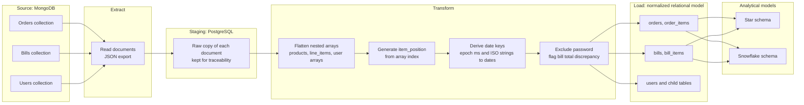
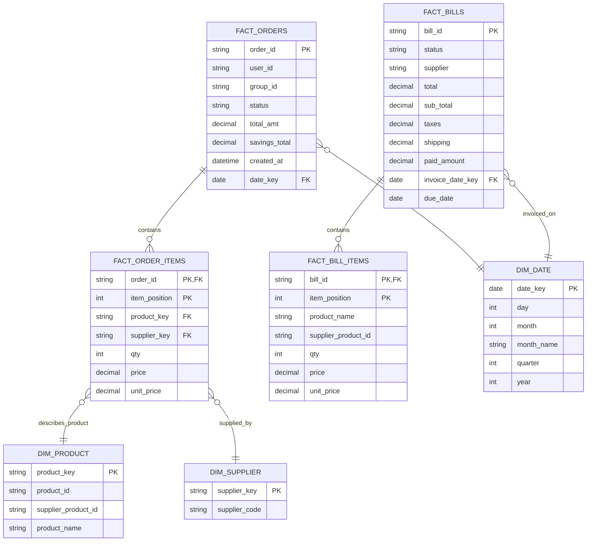
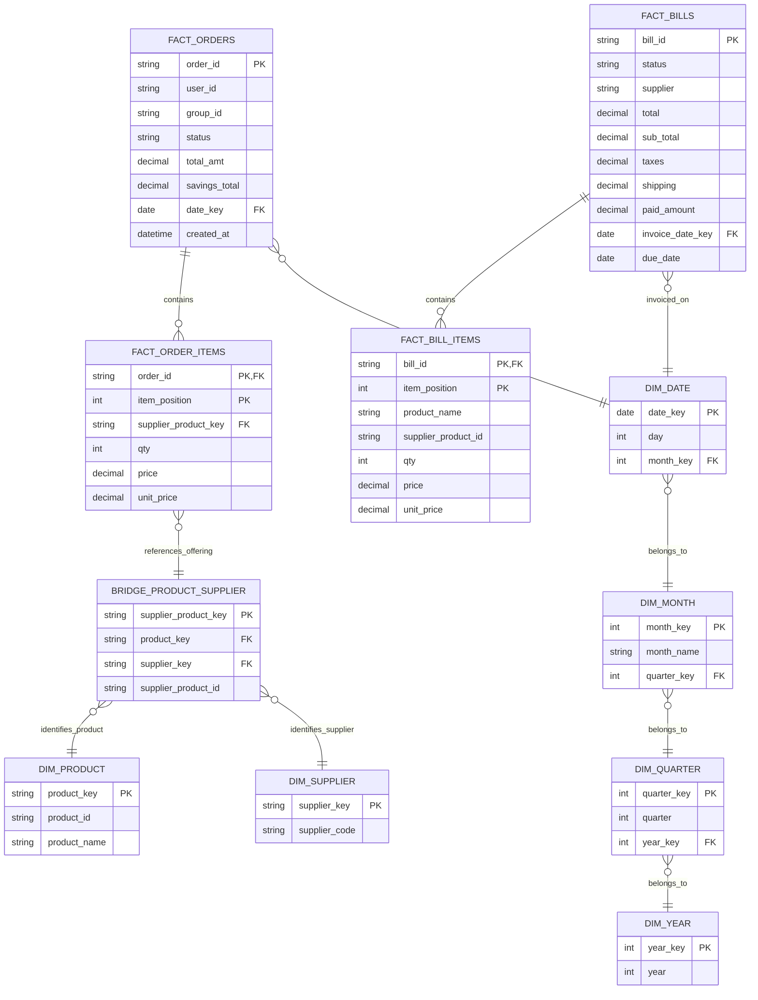

Deployed my 2+ years of hands-on ETL/ELT experience across Snowflake, Informatica IICS, Azure Data Factory, and Databricks/PySpark to build reliable, well-modeled data pipelines as a Data Engineer. I bring a solid foundation in dimensional modeling, SQL, and Python, and I want to grow by designing scalable pipelines that turn raw operational data into trusted, analytics-ready datasets.

# MongoDB to PostgreSQL Data Pipeline Design

Design for migrating three MongoDB collections (Orders, Bills, Users) into a normalized PostgreSQL schema, with Star and Snowflake analytical models.

## Scope

- **Included:** source data profiling scripts, a pipeline architecture diagram, a normalized relational design, Star and Snowflake schemas, and a document of assumptions.
- **Not included:** a production ETL implementation. The pipeline is a design; the scripts in `src/` profile and preview the supplied sample data.
- **Sample data:** each supplied JSON file contains one document, so all findings describe the samples and not the full dataset.

## Repository structure

```
data/        sample source documents (orders.json, bills.json, users.json)
docs/        architecture.mmd, star-schema.mmd, snowflake-schema.mmd, schema_design.md
previews/    CSV previews generated from the sample data
src/         profile_data.py, preview_data.py, check_product_supplier.py
```

## How to run

Requires Python 3. The scripts use only the standard library.

```
python src/profile_data.py
python src/preview_data.py
python src/check_product_supplier.py
```

- `profile_data.py` prints the structure of each source file.
- `preview_data.py` writes one CSV per table into `previews/`.
- `check_product_supplier.py` checks whether a product ID is associated with more than one supplier in the sample.

## Architecture



## Star schema



## Snowflake schema



## Design rationale

- **Star schema:** fewer joins and a flat date dimension, which suits straightforward reporting.
- **Snowflake schema:** removes repeated attributes by splitting the date hierarchy and separating supplier-specific product offerings into their own table, at the cost of extra joins.
- **Shared decisions:** order and bill measures stay at their header grain, and `item_position` is generated in the ETL because the source items have no item-level ID.

## Key assumptions

- Order `user_id` is kept as a plain column because the link to the Users collection could not be verified from the samples.
- Bill items are not linked to products or suppliers, because they carry no product ID and the sample bill's supplier code does not appear among the order supplier codes.
- The sample bill's total differs from its components by 4.00. The source values are preserved and the difference is flagged.
- The password field is excluded from the migration.

The full list of decisions, with each statement tagged as Confirmed, Design, Assumption or Unverified, is in [docs/schema_design.md](docs/schema_design.md). The diagram sources are in `docs/`.


